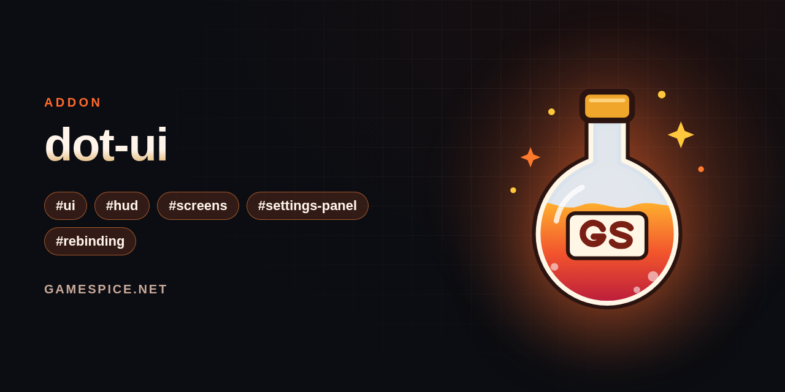

[](https://moddingcommunity.com/a/11-gs-ui)

Screens, HUD and menus for a Godot 4 game, with no art assets. A screen stack that works out z-order, input blocking and mouse mode from one place, a settings panel generated from any `GSConfig`, a rebinder with conflict detection, and data-driven HUD widgets.

A GameSpice addon, MIT licensed, built with Claude Code. Run `examples/ui_selftest.tscn` and `examples/form_selftest.tscn` headless to test it. Every game in [Zee's Games](https://zeesgames.com) draws its menus and HUD with it on live servers. Bug reports go to the [issue tracker](https://github.com/gamespice-platform/ui/issues).

## Install

1. Get [Godot 4.7](https://godotengine.org/download).
2. Either use [GameSpice Bootstrap](https://github.com/gamespice-platform/bootstrap), which clones every project and links the addons, or copy `addons/gs_ui/` and [GameSpice Core](https://github.com/gamespice-platform/core)'s `addons/gs_core/` into your project and enable both in *Project > Project Settings > Plugins*.

GameSpice Core and GameSpice Input are the dependencies (plus Profile). `GSInputBinding` forwards to Input's `GSInputText` and `GSInputMap` instead of keeping a second copy of the key-name and `InputMap` code; link `addons/gs_input` next to `addons/gs_core`.

## Use

```gdscript
var stack := GSScreenStack.new()
add_child(stack)
stack.register(pause_menu)
stack.register(settings_screen)

hud.bind_stack(stack)

# A settings screen, from the config you already have.
settings_panel.bind(server_config)

# A health bar, from the health you already have.
health_bar.bind(func(): return health.health)
```

`GSScreenStack` derives z-order, input blocking, mouse capture and the back key from one stack whenever it changes, so you do not get a pause menu that is visible but not focused or an escape key that closes two screens.

GameSpice UI ships no textures, fonts or nine-patches and knows nothing about GameSpice Match or GameSpice Combat. The theme is generated from `StyleBoxFlat`s, the kill feed takes coloured string fragments and the scoreboard takes rows of dictionaries.

## What is in it

| Class | What it is |
| --- | --- |
| `GSScreenStack`, `GSScreen` | What is open, in what order, and who gets input. |
| `GSUiTheme` | A whole `Theme` from a palette and a scale. |
| `GSHud`, `GSHudWidget` | The always-on layer, and widgets that pull a value rather than being pushed. |
| `GSStatBar` | Health, armour, ammo. |
| `GSCrosshair` | Opens by the actual spread angle through the actual camera projection. |
| `GSStarfield` | A parallax starfield drawn into any `CanvasItem`. |
| `GSFeedView` | A self-expiring list of coloured fragments, for a kill feed or chat. |
| `GSChatWindow` | A chat box: a fading log, a line to type in, and a key that opens it. |
| `GSTableView` | Rows and columns: scoreboard, server browser, ban list. |
| `GSVitals`, `GSAmmoCounter`, `GSScoreStrip` | The glance HUD: health and armour, `magazine \| reserve`, the clock with optional score plates. |
| `GSHitMarker`, `GSDamageNumbers` | Hit ticks (red on a kill) and numbers that rise off where a hit landed. |
| `GSKeyPrompt`, `GSKeyHints` | "Open door [E]" and a column of keys, drawn from the player's binding. |
| `GSBallotPanel` | A GameSpice Vote ballot on the HUD, by number key, click or both, with a countdown and voters' avatars. Emits `chosen`. |
| `GSSettingsPanel` | Builds itself from a `GSConfig`. Never shows a secret. |
| `GSBindingsPanel` | Rebinding with conflict detection, in a file that survives a restart. |
| `GSInputBinding` | One binding as text (`"Y"`, `"Shift+A"`, `"Mouse 1"`) and back. |

## Settings panel

`GSSettingsPanel` reads the `@export` annotations the config already has (keys, types, ranges, enum choices, groups) and builds the controls, so a screen never drifts from the config. It skips `sensitive_keys()`, since secrets end up in screenshots. Edits are held until `apply()`, and an invalid set is rolled back entirely.

## Chat window

It knows nothing about chat: it takes coloured fragments to draw and emits the string somebody typed. `open_action` is an `InputMap` action (`Y` by default), so players rebind it.

```gdscript
var chat := GSChatWindow.new()
chat.submitted.connect(func(text: String, _channel: StringName) -> void:
    link.send_chat(text))
chat.opened.connect(func(_c: StringName) -> void: controller.suspended = true)
chat.closed.connect(func() -> void: controller.suspended = false)
add_child(chat)
```

Connect `opened` and `closed` to whatever suspends your controller. A focused `LineEdit` keeps keys out of `_unhandled_input` but not out of `Input.is_action_pressed`, so without it typing "sw" walks the player backwards. Long lines wrap at word boundaries, and `max_lines` counts drawn rows, not messages.

## Widgets pull

A `GSHudWidget` holds a `Callable` that reads the value, by default ten times a second. A bar wired to a signal misses changes that happened before it existed, and fires repeatedly when several things change in one tick. There is an immediate path for anything where lateness would be wrong.

## Testing

Import the project once, then run `examples/ui_selftest.tscn` and `examples/form_selftest.tscn` headless with Godot. They run offline, render nothing and exit non-zero on failure. Further docs are in [docs/](docs/README.md).

## Used by

All of these games from Zee's Games vendor this addon:

- [Fatal Contact](https://zeesgames.com/fatal-contact)
- [Airdrift](https://zeesgames.com/airdrift)
- [Playlot](https://zeesgames.com/playlot)
- [Hungario](https://zeesgames.com/hungario)
- [Buses From Hell](https://zeesgames.com/buses-from-hell)
- [Smash Copter](https://zeesgames.com/smash-copter)
- [Zombie Zone](https://zeesgames.com/zombie-zone)
- [Hide n Seek](https://zeesgames.com/hide-n-seek)
- [Prop Hunt](https://zeesgames.com/prop-hunt)
- [Murder Mystery](https://zeesgames.com/murder-mystery)
- [Deathrun](https://zeesgames.com/deathrun)
- [Wipeout](https://zeesgames.com/wipeout)
- [Dangerous Delivery](https://zeesgames.com/dangerous-delivery)
- [Look At Me](https://zeesgames.com/look-at-me)

The whole collection is at [zeesgames.com](https://zeesgames.com).

## Credits

The one exception to "no art" is an optional weapon icon sheet. `GSIconSet` works without it; `GSWeaponIcons.stock()` adds it.

| Asset | Author / source | Licence |
| --- | --- | --- |
| Weapon icon sheet (18 kB) | Jestan, [The Ultimate Weapons Pack](https://jestan.itch.io/weapons-pack) | CC0 1.0 |

The itch.io page says CC0, and the author confirms in its comment thread that the licence file inside the zip is outdated. Details in `addons/gs_ui/icons/jestan/CREDITS.md`.

## Licence

MIT licence, see [LICENSE](LICENSE). The only closed part of the [**GameSpice**](https://gamespice.net) platform is the web back end; you can use your own instead of GameSpice's.
